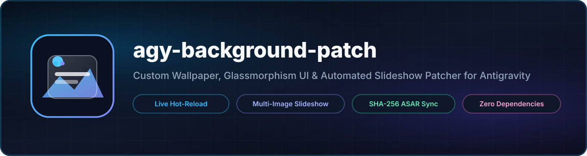
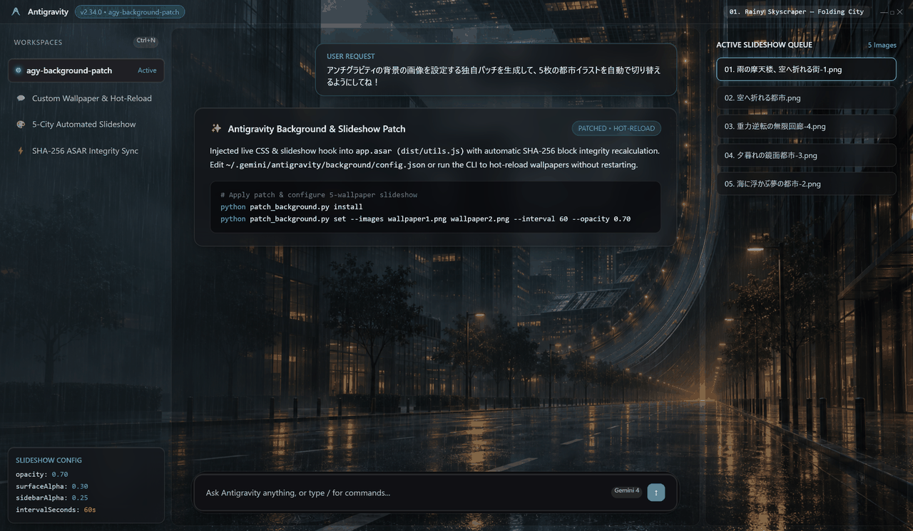
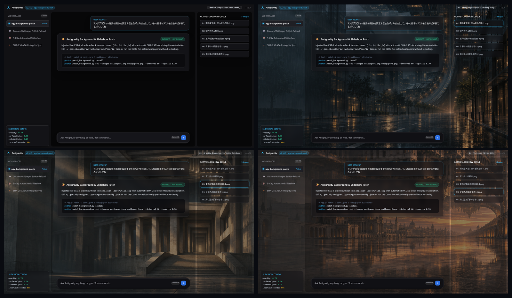
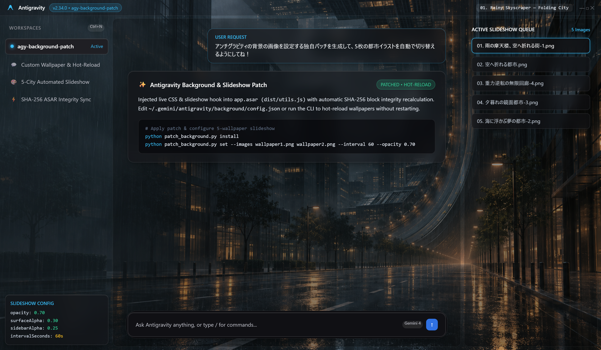
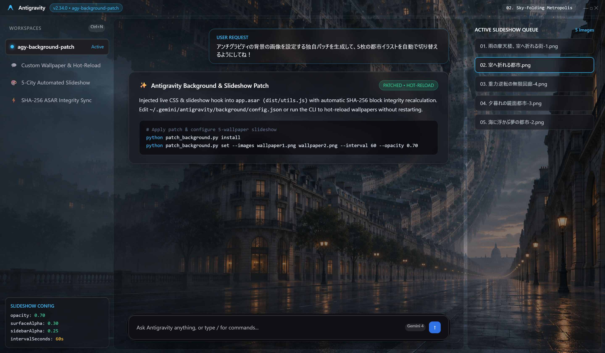
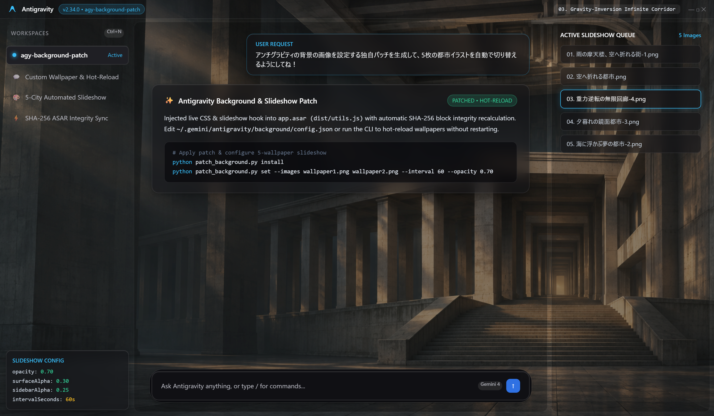
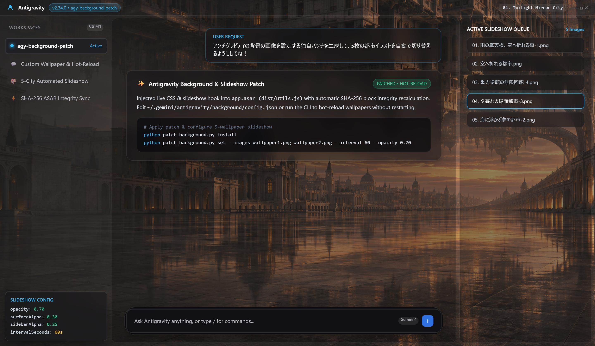
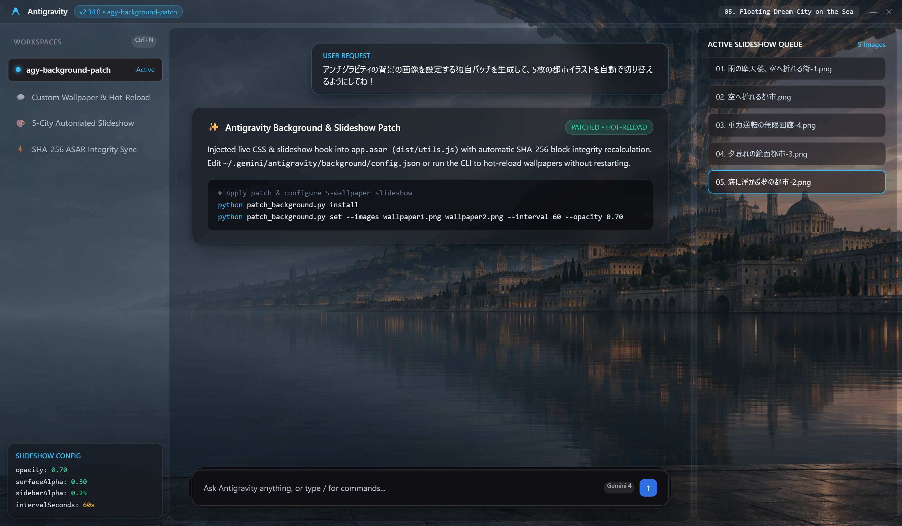
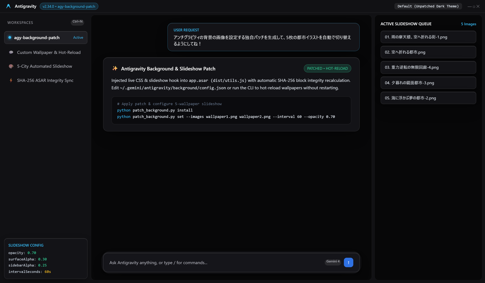

<div align="center">
  

  <h1>agy-background-patch</h1>
  <p><strong>Google Antigravity 用カスタム背景壁紙・すりガラスUI・自動スライドショーパッチ</strong></p>

  <p>
    <a href="https://github.com/Sunwood-ai-labs/agy-background-patch/actions/workflows/ci.yml"></a>
    <a href="https://github.com/Sunwood-ai-labs/agy-background-patch/blob/main/LICENSE"></a>
    
    
    
  </p>

  <p>
    <strong>🌐 Language:</strong>
    <a href="./README.md">English</a> |
    <a href="./README.ja.md"><strong>日本語</strong></a>
  </p>
</div>

---

## ✨ 概要

**`agy-background-patch`** は、**Google Antigravity** デスクトップアプリ（`app.asar`）にカスタム背景壁紙と複数画像の自動スライドショー機能、およびグラスモーフィズム（すりガラス）UI透過効果を注入する外部依存ゼロの Python パッチツール＆CLIです。

`app.asar` 内の `dist/utils.js` を安全に展開・パッチ適用し、Chromium Pickle ヘッダーと 4 MiB ブロック単位の **SHA-256 ASAR Integrity ハッシュ** を自動再計算します。さらに `~/.gemini/antigravity/background/config.json` をファイル監視（`fs.watch`）するため、一度パッチを適用した後は **Antigravity を再起動することなくリアルタイム（ホットリロード）で壁紙や濃さ・透過度を切り替えられます**。

---

## 📸 スクリーンショット＆スライドショープレビュー

### 自動スライドショープレビュー（5枚の幻想都市イラスト）

<div align="center">
  
</div>

### 2×2 比較グリッド（デフォルト vs カスタム背景適用後）

<div align="center">
  
</div>

### 各壁紙の適用スクリーンショット一覧

| 01. 雨の摩天楼、空へ折れる街 | 02. 空へ折れる都市 |
| :---: | :---: |
|  |  |

| 03. 重力逆転の無限回廊 | 04. 夕暮れの鏡面都市 |
| :---: | :---: |
|  |  |

| 05. 海に浮かぶ夢の都市 | パッチ適用前（デフォルトダークテーマ） |
| :---: | :---: |
|  |  |

---

## 🚀 主な特徴

- **🔄 複数画像の自動スライドショー**: `--images` または `config.json` の `images` 配列に複数の画像パスを登録すると、`intervalSeconds`（デフォルト60秒）ごとに自動で壁紙が切り替わります（順番通り／ランダム `--shuffle` 両対応）。
- **⚡ 再起動不要のライブ・ホットリロード**: `~/.gemini/antigravity/background/config.json` を監視しており、設定変更や CLI コマンド実行の瞬間に開いている全ウィンドウへ即時反映されます。
- **🪟 深層グラスモーフィズム透過制御**: `--color-background`、`--color-sidebar`、`--color-card`、`.agy-shell`、`.agy-sheet` などの多重背景レイヤーを `color-mix(in srgb, ...)` と `backdrop-filter: blur(12px)` で一括透過し、文字の可読性を保ちながら背景イラストを鮮明に表示します。
- **🛡️ 内蔵ブラウザ表示時の自動退避**: Antigravity の内蔵ブラウザタブ（`body[data-has-browser-hole="true"]`）が開いている間は自動的に背景レイヤーを非表示にし、Webページの表示を妨げません。
- **🔒 自動バックアップ＆ワンコマンド復元**: 初回パッチ時にオリジナルの `app.asar` を `app.asar.bak` として保存し、`uninstall` コマンドでいつでも元の状態へ完全復元できます。

---

## 📦 クイックスタート

### 1. Antigravity にパッチをインストールする

```powershell
uv run python patch_background.py install
```

> **注意:** `install` 実行後、Electron にパッチ済みの `app.asar` を読み込ませるため **初回のみ Antigravity を再起動** してください。再起動した後は、`set` コマンドや `config.json` の編集がすべて再起動なしでリアルタイムに反映されます！

### 2. 単一画像または複数枚の自動スライドショーを設定する

**単一の壁紙を設定する場合:**

```powershell
uv run python patch_background.py set `
  --image "C:\path\to\wallpaper.png" `
  --opacity 0.70 `
  --surface-alpha 0.30 `
  --sidebar-alpha 0.25 `
  --card-alpha 0.55
```

**複数枚の画像を自動スライドショーで切り替える場合（例: 5枚を60秒間隔でローテーション）:**

```powershell
uv run python patch_background.py set --images `
  "C:\Users\makim\Downloads\雨の摩天楼、空へ折れる街-1.png" `
  "C:\Users\makim\Downloads\空へ折れる都市.png" `
  "C:\Users\makim\Downloads\重力逆転の無限回廊-4.png" `
  "C:\Users\makim\Downloads\夕暮れの鏡面都市-3.png" `
  "C:\Users\makim\Downloads\海に浮かぶ夢の都市-2.png" `
  --interval 60 `
  --no-shuffle `
  --opacity 0.70 `
  --surface-alpha 0.30 `
  --sidebar-alpha 0.25
```

---

## ⚙️ 設定ファイルリファレンス (`config.json`)

設定ファイルは `~/.gemini/antigravity/background/config.json`（Windows では `C:\Users\<ユーザー名>\.gemini\antigravity\background\config.json`）に保存されます。エディタで直接編集して保存するだけでも即座に反映されます。

```json
{
  "enabled": true,
  "images": [
    "C:/Users/makim/Downloads/雨の摩天楼、空へ折れる街-1.png",
    "C:/Users/makim/Downloads/空へ折れる都市.png",
    "C:/Users/makim/Downloads/重力逆転の無限回廊-4.png",
    "C:/Users/makim/Downloads/夕暮れの鏡面都市-3.png",
    "C:/Users/makim/Downloads/海に浮かぶ夢の都市-2.png"
  ],
  "intervalSeconds": 60,
  "shuffle": false,
  "opacity": 0.70,
  "blur": 0,
  "brightness": 1.0,
  "size": "cover",
  "position": "center center",
  "surfaceAlpha": 0.30,
  "sidebarAlpha": 0.25,
  "cardAlpha": 0.55
}
```

| キー | 型 | デフォルト | 説明 |
| :--- | :--- | :--- | :--- |
| `enabled` | `boolean` | `true` | 背景壁紙の有効 (`true`) / 一時無効化 (`false`) |
| `images` | `string[]` | `[]` | 自動スライドショーで切り替える画像パスまたは `https://` URL の配列 |
| `image` | `string` | `""` | 単一画像モード時の画像パスまたは URL |
| `intervalSeconds` | `number` | `60` | スライドショーの切り替え間隔（秒・最小 `3` 秒） |
| `shuffle` | `boolean` | `false` | `true` にするとランダム順、`false` でリスト順に切り替え |
| `opacity` | `number` | `0.70` | 背景画像レイヤー自体の不透明度 (`0.0` 〜 `1.0`。高いほど背景が濃く見える) |
| `blur` | `number` | `0` | 背景画像にかけるぼかし半径 (px) |
| `brightness` | `number` | `1.0` | 背景画像の明るさ倍率 |
| `size` | `string` | `"cover"` | CSS `background-size` (`"cover"`, `"contain"` など) |
| `position` | `string` | `"center center"` | CSS `background-position` |
| `surfaceAlpha` | `number` | `0.30` | メインのチャット・コンテンツ領域の背景不透明度 (`0.0` 〜 `1.0`。低いほど背景が透けて見える) |
| `sidebarAlpha` | `number` | `0.25` | サイドバー・外枠シェルの背景不透明度 (`0.0` 〜 `1.0`) |
| `cardAlpha` | `number` | `0.55` | チャットカード・下部コンポーザー入力欄のすりガラス不透明度 (`0.0` 〜 `1.0`) |

---

## 🛠️ CLI コマンド一覧

```powershell
# パッチ適用状態と現在の config.json を確認する
uv run python patch_background.py status

# パッチのインストール／アップデート後の再適用
uv run python patch_background.py install

# 背景の濃さやスライドショー間隔をリアルタイム変更する
uv run python patch_background.py set --opacity 0.80 --surface-alpha 0.20 --interval 30 --shuffle

# 実行中の Antigravity ウィンドウから直接 PNG スクリーンショットを撮影する
uv run python patch_background.py screenshot --output ./my-window.png

# パッチをアンインストールして元の app.asar.bak に戻す
uv run python patch_background.py uninstall
```

---

## 🏗️ 仕組み（アーキテクチャ）

1. **ASAR 展開・再構築**: `resources/app.asar` の 16 バイト Chromium Pickle プリアンブルと JSON ヘッダーを解析して `dist/utils.js` を抽出し、`attachLoadingOverlay(win, foregroundColor, backgroundColor)` の直後に背景管理 IIFE を注入します。
2. **Data-URL 注入＆メモリキャッシュ**: Electron メインプロセス側でローカル画像ファイルを読み込み、`data:image/*;base64,...` 形式（`mtimeMs` とファイルサイズによる LRU キャッシュ付き）に変換した上で `hubContents.insertCSS(css, { cssOrigin: 'user' })` により注入します。これにより HTTPS ループバック Origin の Mixed Content 制限や `file://` 制限を完全に回避します。
3. **SHA-256 Integrity 再計算**: ファイル変更後に ASAR ヘッダー内の全体 SHA-256 ハッシュおよび 4 MiB ブロックハッシュを再計算し、Electron の整合性検証をパスさせます。

---

## 📄 ライセンス

[MIT License](./LICENSE) © 2026 Sunwood AI Labs.
