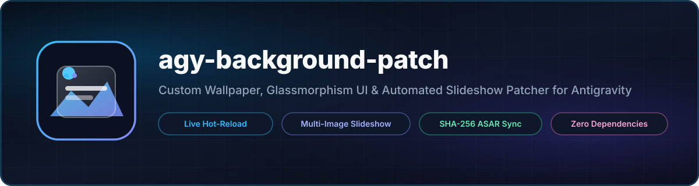
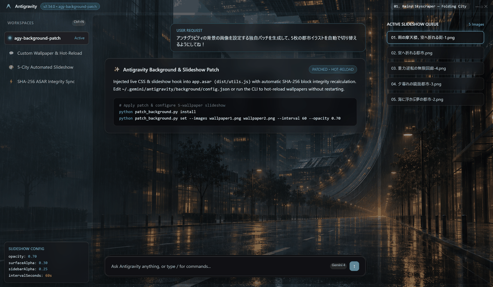
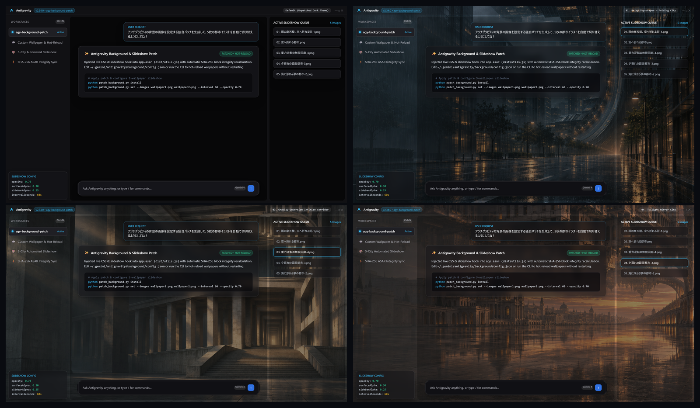
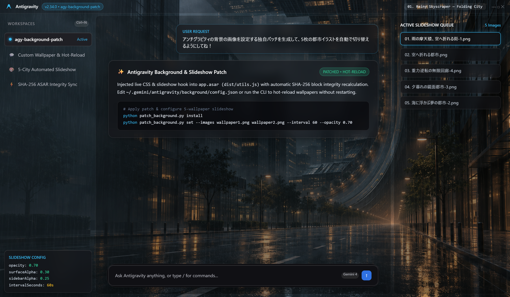
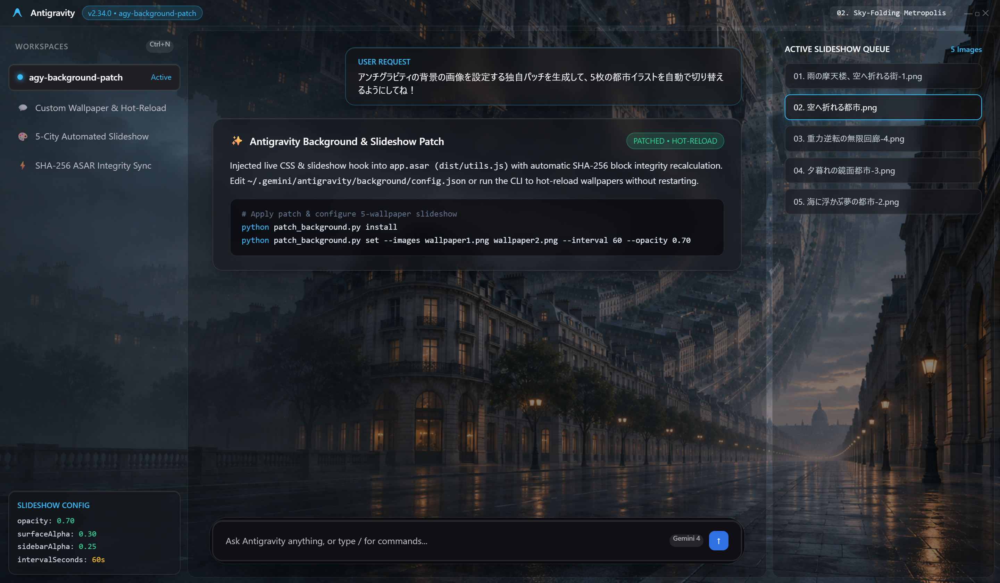
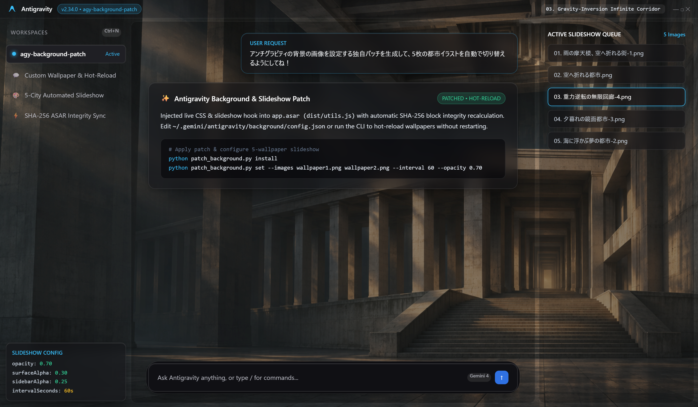
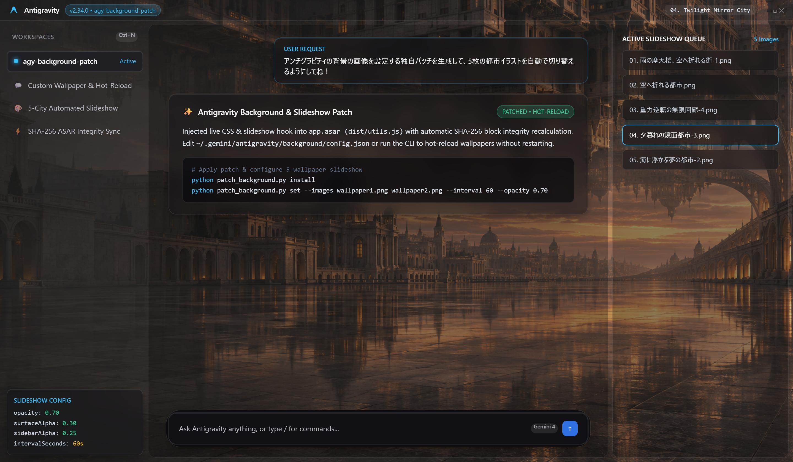
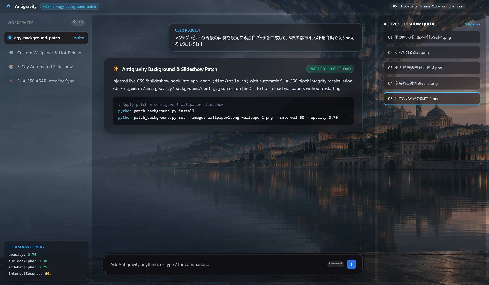
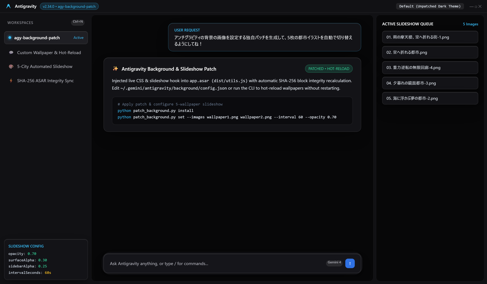

<div align="center">
  

  <h1>agy-background-patch</h1>
  <p><strong>Custom Wallpaper, Glassmorphism UI &amp; Automated Slideshow Patcher for Google Antigravity</strong></p>

  <p>
    <a href="https://github.com/Sunwood-ai-labs/agy-background-patch/actions/workflows/ci.yml"></a>
    <a href="https://github.com/Sunwood-ai-labs/agy-background-patch/blob/main/LICENSE"></a>
    
    
    
  </p>

  <p>
    <strong>🌐 Language:</strong>
    <a href="./README.md"><strong>English</strong></a> |
    <a href="./README.ja.md">日本語</a>
  </p>
</div>

---

## ✨ Overview

**`agy-background-patch`** is a zero-dependency Python patcher and CLI manager that injects a live-reloading custom wallpaper and multi-image slideshow engine into the **Google Antigravity** desktop app (`app.asar`).

It automatically unpacks and repacks `dist/utils.js` inside `app.asar`, recalculates Chromium Pickle headers and 4 MiB block **SHA-256 ASAR integrity hashes**, and watches `~/.gemini/antigravity/background/config.json` so that any changes to your wallpaper, slideshow queue, opacity, blur, or glassmorphism surface alpha take effect **instantly without restarting Antigravity**.

---

## 📸 Screenshots &amp; Slideshow Preview

### Animated Slideshow Preview (5 Architectural Fantasy Cities)

<div align="center">
  
</div>

### 2×2 Comparison Grid (Default vs. Custom Wallpapers)

<div align="center">
  
</div>

### Individual Wallpaper Captures

| 01. Rainy Skyscraper — Folding City | 02. Sky-Folding Metropolis |
| :---: | :---: |
|  |  |

| 03. Gravity-Inversion Infinite Corridor | 04. Twilight Mirror City |
| :---: | :---: |
|  |  |

| 05. Floating Dream City on the Sea | Default Unpatched Dark Theme (Before) |
| :---: | :---: |
|  |  |

---

## 🚀 Key Features

- **🔄 Automated Multi-Image Slideshow**: Pass multiple images via `--images` or the `images` JSON array to rotate wallpapers automatically every `intervalSeconds` (sequential or `--shuffle`).
- **⚡ Real-Time Hot-Reload**: Watches `~/.gemini/antigravity/background/config.json` via `fs.watch`. Adjust opacity, blur, brightness, or swap images on the fly with zero app restarts.
- **🪟 Deep Glassmorphism Surface Control**: Overrides `--color-background`, `--color-sidebar`, `--color-card`, `.agy-shell`, and `.agy-sheet` layers with `color-mix(in srgb, ...)` and `backdrop-filter: blur(12px)` so your wallpaper shines through clearly while keeping code and chat text crisp.
- **🛡️ Built-In Browser Hole Protection**: Automatically disables background overrides when Antigravity's native browser tab view (`body[data-has-browser-hole="true"]`) is active so web previews remain 100% unobstructed.
- **🔒 Safe ASAR Integrity &amp; Instant Rollback**: Creates a clean backup (`app.asar.bak`) before patching and recalculates every file's SHA-256 block integrity hash.

---

## 📦 Quick Start

### 1. Install the Patch into Antigravity

```powershell
uv run python patch_background.py install
```

> **Note:** Restart Antigravity **once** after running `install` so Electron loads the patched `app.asar`. All subsequent `set` commands and `config.json` edits apply live!

### 2. Configure a Single Wallpaper or Multi-Image Slideshow

**Single image:**

```powershell
uv run python patch_background.py set `
  --image "C:\path\to\wallpaper.png" `
  --opacity 0.70 `
  --surface-alpha 0.30 `
  --sidebar-alpha 0.25 `
  --card-alpha 0.55
```

**Multi-image automatic slideshow (e.g., 5 images rotating every 60 seconds):**

```powershell
uv run python patch_background.py set --images `
  "C:\Users\makim\Downloads\雨の摩天楼、空へ折れる街-1.png" `
  "C:\Users\makim\Downloads\空へ折れる都市.png" `
  "C:\Users\makim\Downloads\重力逆転の無限回廊-4.png" `
  "C:\Users\makim\Downloads\夕暮れの鏡面都市-3.png" `
  "C:\Users\makim\Downloads\海に浮かぶ夢の都市-2.png" `
  --interval 60 `
  --no-shuffle `
  --opacity 0.70 `
  --surface-alpha 0.30 `
  --sidebar-alpha 0.25
```

---

## ⚙️ Configuration Reference (`config.json`)

The configuration file lives at `~/.gemini/antigravity/background/config.json` (`C:\Users\<you>\.gemini\antigravity\background\config.json` on Windows). Saving this file in any text editor triggers an immediate hot-reload in Antigravity:

```json
{
  "enabled": true,
  "images": [
    "C:/Users/makim/Downloads/雨の摩天楼、空へ折れる街-1.png",
    "C:/Users/makim/Downloads/空へ折れる都市.png",
    "C:/Users/makim/Downloads/重力逆転の無限回廊-4.png",
    "C:/Users/makim/Downloads/夕暮れの鏡面都市-3.png",
    "C:/Users/makim/Downloads/海に浮かぶ夢の都市-2.png"
  ],
  "intervalSeconds": 60,
  "shuffle": false,
  "opacity": 0.70,
  "blur": 0,
  "brightness": 1.0,
  "size": "cover",
  "position": "center center",
  "surfaceAlpha": 0.30,
  "sidebarAlpha": 0.25,
  "cardAlpha": 0.55
}
```

| Field | Type | Default | Description |
| :--- | :--- | :--- | :--- |
| `enabled` | `boolean` | `true` | Enable (`true`) or temporarily disable (`false`) the background wallpaper |
| `images` | `string[]` | `[]` | Array of local image paths or `https://` URLs for automatic slideshow rotation |
| `image` | `string` | `""` | Fallback single image path/URL when `images` is not specified |
| `intervalSeconds` | `number` | `60` | Slideshow rotation interval in seconds (minimum `3`) |
| `shuffle` | `boolean` | `false` | Pick the next slide randomly (`true`) instead of sequential order (`false`) |
| `opacity` | `number` | `0.70` | Wallpaper layer opacity (`0.0` to `1.0`) |
| `blur` | `number` | `0` | CSS `blur(Npx)` filter applied to the wallpaper layer |
| `brightness` | `number` | `1.0` | CSS `brightness(N)` multiplier applied to the wallpaper layer |
| `size` | `string` | `"cover"` | CSS `background-size` (`"cover"`, `"contain"`, etc.) |
| `position` | `string` | `"center center"` | CSS `background-position` |
| `surfaceAlpha` | `number` | `0.30` | Opaque percentage (`0.0` to `1.0`) of main content panels (lower = more wallpaper visible) |
| `sidebarAlpha` | `number` | `0.25` | Opaque percentage (`0.0` to `1.0`) of the sidebar and outer shell frame |
| `cardAlpha` | `number` | `0.55` | Opaque percentage (`0.0` to `1.0`) of chat cards and the bottom glass composer |

---

## 🛠️ CLI Commands

```powershell
# Check current patch status and active config.json
uv run python patch_background.py status

# Install or update the patch in app.asar (after an Antigravity auto-update)
uv run python patch_background.py install

# Adjust opacity or slideshow speed live
uv run python patch_background.py set --opacity 0.80 --surface-alpha 0.20 --interval 30 --shuffle

# Capture a live PNG screenshot from the running Antigravity window
uv run python patch_background.py screenshot --output ./my-window.png

# Uninstall the patch and restore the original app.asar.bak
uv run python patch_background.py uninstall
```

---

## 🏗️ How It Works

1. **ASAR Extraction &amp; Rebuilding**: Reads the 16-byte Chromium Pickle preamble and JSON header from `resources/app.asar`, extracts `dist/utils.js`, and injects a self-contained IIFE right after `attachLoadingOverlay(win, foregroundColor, backgroundColor)`.
2. **Data-URL Injection &amp; LRU Caching**: Reads local images via Node's `fs.readFileSync` in the Electron main process, encodes them as `data:image/*;base64,...` strings (cached by `mtimeMs` + `size`), and injects the stylesheet via `hubContents.insertCSS(css, { cssOrigin: 'user' })`. This bypasses HTTPS loopback mixed-content and `file://` origin restrictions cleanly.
3. **SHA-256 Integrity Recalculation**: Recomputes the full-file SHA-256 hash and 4 MiB block hashes in the ASAR header so Electron's package verifier accepts the modified archive without error.

---

## 📄 License

Released under the [MIT License](./LICENSE) © 2026 Sunwood AI Labs.
